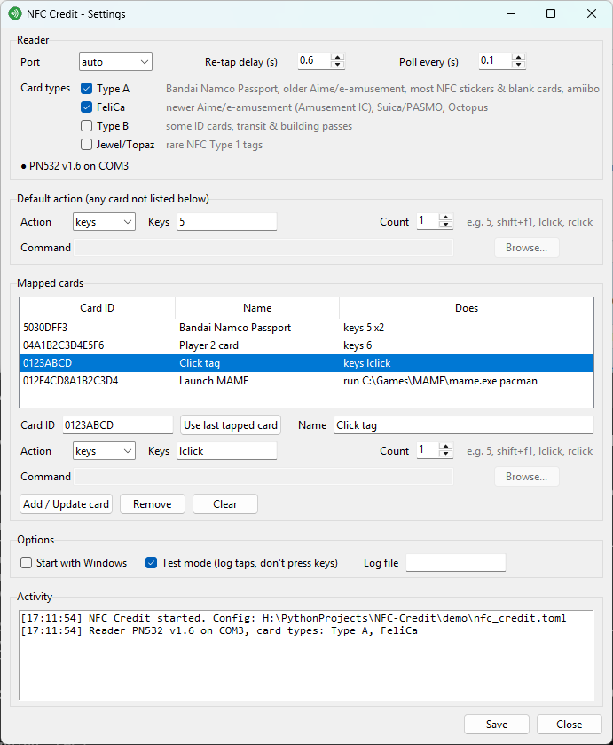

# NFC Credit

Tap an NFC card on a USB reader and your arcade cabinet gets a credit.

NFC Credit sits in the Windows system tray and watches a PN532 NFC reader. When a card is tapped it presses a key (default **5**, the MAME coin key), clicks the mouse, or launches a program. Every card can have its own action.

> **About this project:** NFC Credit is a small personal project, built to make a home MAME cabinet feel a bit more like the real arcade. It's meant to be simple: tap a card to add credits, launch programs on the cab, or log in to games that use a card or key sequence. It isn't a commercial product and there's no support, but feel free to use it if it fits your setup.



## Features

- Works with **any card**: Bandai Namco Passport, Aime, e-amusement, NFC stickers, blank NFC cards, amiibo, transit cards
- **Per-card actions**: different keys, key combos (`shift+f1`), mouse clicks (`lclick`, `rclick`), repeat counts, or launch a program
- **Default action** for cards you haven't set up
- Sends real hardware scan codes, so MAME and other emulators see the keypresses
- **Finds the reader automatically**, even if its COM port changes
- **Tray icon** shows status at a glance
- **Test mode** to try cards without pressing anything
- **Start with Windows** option
- Single portable `.exe` with no install, plus a plain-text config file

## Requirements

- Windows 10 or 11
- A **PN532 NFC reader** connected over USB serial (CH340 or similar), e.g. the common Teyleten Robot / Elechouse-style PN532 boards with a USB-UART adapter

## Getting started

1. **Download** the latest `NFC-Credit-vX.Y.Z.zip` from the [Releases](../../releases) page and unzip it anywhere, e.g. `C:\Arcade\NFC-Credit\`.
2. **Close NFC Tools** or any other program using the reader. Only one program can use the COM port at a time.
3. **Run `NFC-Credit.exe`.** The first time, the Settings window opens and a `nfc_credit.toml` config file is created next to the exe.
   > Windows SmartScreen may warn about an unrecognised app. Click **More info → Run anyway**.
4. Check the status line under **Reader**. It should say something like `● PN532 v1.6 on COM3`.
5. **Tap a card.** It appears in the **Activity** log, and by default the key **5** is pressed.

That's it. Out of the box every card adds a credit in MAME.

### The tray icon

Look for the icon near the clock. Windows may hide it behind the **^** arrow; drag it onto the taskbar to keep it visible.


**Right-click** the icon for **Settings**, **Test mode**, **Open config file** and **Quit**. **Double-click** to open Settings.

## Setting up cards

### Change what every card does

Edit the **Default action** at the top of Settings, then click **Save**.

### Give a specific card its own action

1. Open **Settings** and **tap the card** on the reader.
2. Under **Mapped cards**, click **Use last tapped card**. The Card ID is filled in.
3. Type a **Name** (optional), choose an **Action**, and fill in **Keys** or **Command**.
4. Click **Save**.

### Actions

| Action | What it does | Example |
|---|---|---|
| `keys` | Presses keys in order, `Count` times | `5` · `5, 6` · `shift+f1` |
| `run` | Starts a program | `C:\Games\MAME\mame.exe pacman` |
| `ignore` | Does nothing | handy for blocking a card |

**Key names:** `a`–`z`, `0`–`9`, `f1`–`f12`, `esc`, `enter`, `space`, `tab`, `backspace`, `up` `down` `left` `right`, `shift` `ctrl` `alt`, `insert` `delete` `home` `end` `pageup` `pagedown`, `minus` `equals`, `numpad0`–`numpad9`, `numpadenter`

**Mouse:** `lclick`, `rclick`, `mclick` (click at the current pointer position). For a double-click, use `lclick` with Count `2`.

Separate several keys with commas (`5, lclick`) and join a combo with `+` (`ctrl+alt+x`).

### Reader settings

| Setting | Meaning |
|---|---|
| **Port** | `auto` finds the reader on any COM port. Pick a port only to force one. |
| **Re-tap delay** | How long a card must be off the reader before it counts as a new tap (default 0.6 s). A card left on the reader only triggers once. |
| **Poll every** | How often the reader checks for a card. `0.05` is the most responsive; `0.2` still feels instant and makes the reader's LEDs blink less. |
| **Card types** | Which card families to look for. Fewer types = less reader traffic. |

| Card type | Used by |
|---|---|
| **Type A** | Bandai Namco Passport, older Aime/e-amusement, most NFC stickers and blank cards, amiibo |
| **FeliCa** | Newer Aime/e-amusement (Amusement IC), Suica/PASMO, Octopus |
| **Type B** | Some ID cards, transit and building passes |
| **Jewel/Topaz** | Rare NFC Type 1 tags |

Phones (Apple/Google Pay), e-passports and some bank cards use a random ID on every tap. They still trigger the default action but can't be mapped to their own.

## Config file

Everything in Settings is stored in `nfc_credit.toml` next to the exe. You can also edit it by hand; changes are picked up automatically when the file is saved.

```toml
[reader]
port = "auto"
remove_time = 0.6
poll_interval = 0.1
card_types = ["type_a", "felica"]

[options]
log_file = ""          # e.g. "nfc_credit.log"

[default]              # any card not listed below
action = "keys"
keys = ["5"]
count = 1

[cards."5030DFF3"]
name = "Bandai Namco Passport"
action = "keys"
keys = ["5"]
count = 2

[cards."0123ABCD"]
name = "Click tag"
action = "keys"
keys = ["lclick"]

[cards."012E4CD8A1B2C3D4"]
name = "Launch MAME"
action = "run"
command = 'C:\Games\MAME\mame.exe pacman'
```

## Command line

```
NFC-Credit.exe              start in the tray
NFC-Credit.exe --test       start in test mode (log taps, no actions)
NFC-Credit.exe --settings   open Settings on start
NFC-Credit.exe --config path\to\other.toml
```

## Troubleshooting

- **Status says "Searching for reader..."**: Make sure the reader is plugged in and that NFC Tools (or anything else using the COM port) is closed.
- **Taps show in Activity but nothing happens in the game**: Check Test mode is off (the tray icon turns purple in test mode). If the game runs as administrator, run NFC Credit as administrator too; Windows blocks simulated input into elevated programs.
- **"Already running"**: NFC Credit is already in the tray. Look behind the **^** arrow.

## Building from source

Requires Python 3.11 or newer.

```bat
pip install -r requirements.txt pyinstaller
build.bat
```

The exe is written to `dist\NFC-Credit.exe`. You can also run it directly with `python nfc_credit.py`.

Pushing a tag like `v1.0.0` builds the exe on GitHub Actions and publishes it as a release.
