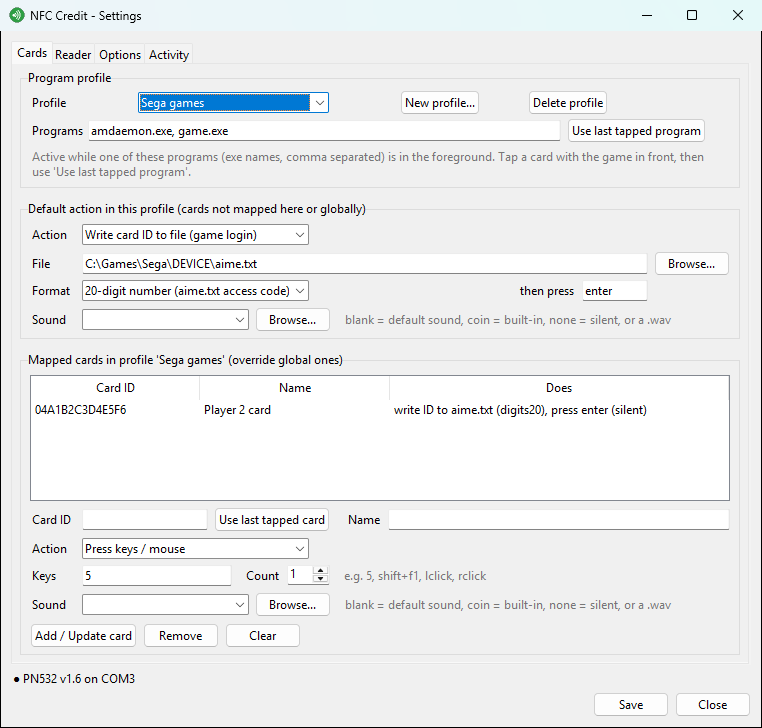
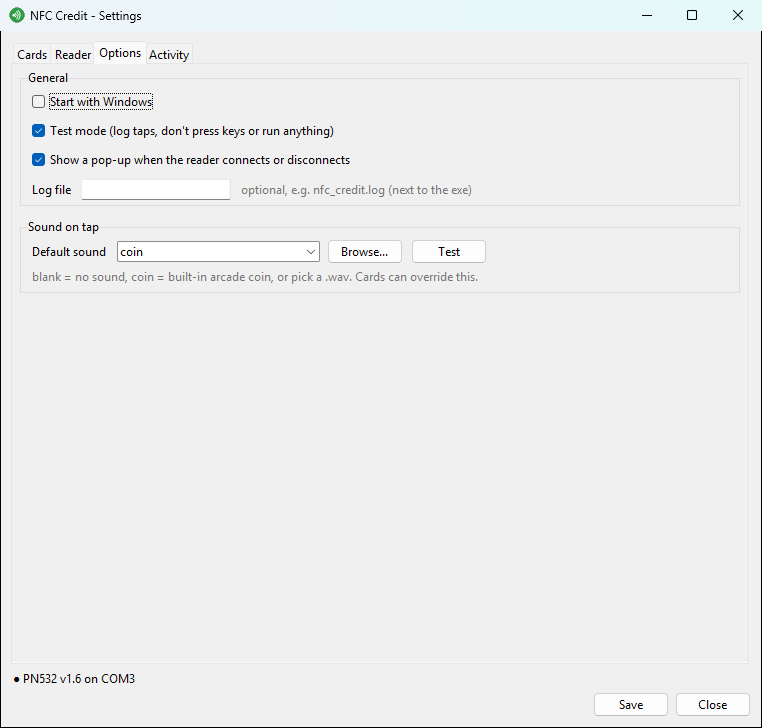

# NFC Credit

> **About this project:** NFC Credit is a small personal project, built to make a home MAME cabinet feel a bit more like the real arcade. It's meant to be simple: tap a card to add credits, launch programs on the cab, or log in to games that use a card or key sequence. It isn't a commercial product and there's no support, but feel free to use it if it fits your setup.

Tap an NFC card on a USB reader and your arcade cabinet gets a credit.

NFC Credit sits in the Windows system tray and watches a PN532 NFC reader. When a card is tapped it presses a key (default **5**, the MAME coin key). It can also click the mouse, type text, launch a program, or write the card's ID to a file so a game can log you in. Every card can have its own action, and actions can change depending on which program is in front.


## Features

- Works with **any card**: Bandai Namco Passport, Aime, e-amusement, NFC stickers, blank NFC cards, amiibo, transit cards
- **Per-card actions**: keys, key combos (`shift+f1`), mouse clicks (`lclick`, `rclick`), typed text, launching programs, or writing the card ID to a file for game logins
- **Program profiles**: the same card can do different things in different games
- **Default action** for cards you haven't set up
- Optional **coin sound** on every tap (built-in, or your own `.wav`)
- **Pop-up** when the reader connects or disconnects
- Sends real hardware scan codes, so MAME and other emulators see the keypresses
- **Finds the reader automatically**, even if its COM port changes
- **Tray icon** shows status at a glance
- **Test mode** to try cards without pressing anything
- **Start with Windows** option
- Single portable `.exe` with no install, plus a plain-text config file

Everything beyond the basics is optional. Out of the box, any card simply presses **5**.

## Requirements

- Windows 10 or 11 (64-bit)
- A **PN532 NFC reader** connected over USB serial (CH340 or similar), e.g. the common Teyleten Robot / Elechouse-style PN532 boards with a USB-UART adapter
- The **CH340 USB driver**. Windows Update normally installs it automatically when the reader is plugged in. On an offline PC, install `CH341SER.EXE` from the chip maker, WCH.

## Getting started

1. **Download** the latest `NFC-Credit-vX.Y.Z.zip` from the [Releases](../../releases) page and unzip it anywhere writable, e.g. `C:\Arcade\NFC-Credit\` (not `C:\Program Files`).
2. **Close NFC Tools** or any other program using the reader. Only one program can use the COM port at a time.
3. **Run `NFC-Credit.exe`.** The first time, the Settings window opens and a `nfc_credit.toml` config file is created next to the exe.
   > Windows SmartScreen may warn about an unrecognised app. Click **More info → Run anyway**.
4. Check the status line at the bottom of Settings. It should say something like `● PN532 v1.6 on COM3`, and a pop-up confirms the reader is connected.
5. **Tap a card.** The status line shows the card ID, the **Activity** tab logs it, and by default the key **5** is pressed.

That's it. Out of the box every card adds a credit in MAME.

### The tray icon

Look for the icon near the clock. Windows may hide it behind the **^** arrow; drag it onto the taskbar to keep it visible.


**Right-click** the icon for **Settings**, **Test mode**, **Open config file** and **Quit**. **Double-click** to open Settings.

## Setting up cards

### Change what every card does

Edit the **Default action** on the **Cards** tab, then click **Save**.

### Give a specific card its own action

1. Open **Settings** and **tap the card** on the reader.
2. Under **Mapped cards**, click **Use last tapped card**. The Card ID is filled in.
3. Type a **Name** (optional), choose an **Action**, and fill in its fields.
4. Click **Save**.

### Actions

| Action | What it does | Example |
|---|---|---|
| **Press keys / mouse** | Presses keys or mouse buttons in order, `Count` times | `5` · `5, 6` · `shift+f1` · `lclick` |
| **Type text** | Types a piece of text, optionally pressing Enter after | a player name or PIN for a front-end or launcher login |
| **Run program** | Starts a program | `C:\Games\MAME\mame.exe pacman` |
| **Write card ID to file** | Writes the card's ID to a text file, then presses a key | game logins, see below |
| **Do nothing** | Ignores the card | handy for blocking a card |

**Key names:** `a`–`z`, `0`–`9`, `f1`–`f12`, `esc`, `enter`, `space`, `tab`, `backspace`, `up` `down` `left` `right`, `shift` `ctrl` `alt`, `insert` `delete` `home` `end` `pageup` `pagedown`, `minus` `equals`, `numpad0`–`numpad9`, `numpadenter`

**Mouse:** `lclick`, `rclick`, `mclick` (click at the current pointer position). For a double-click, use `lclick` with Count `2`.

Separate several keys with commas (`5, lclick`) and join a combo with `+` (`ctrl+alt+x`).

Typed text is sent as real keystrokes, so it works in games as well as normal windows. The Activity log only shows how many characters were typed, not the text itself.

### Game logins with your real card

Some game loaders read the player's card from a text file and wait for a "scan" key, for example segatools-style `DEVICE\aime.txt` (a 20-digit access code) or `felica.txt` (16 hex digits). The **Write card ID to file** action does that:

| Field | Meaning |
|---|---|
| **File** | The card file the game reads, e.g. `C:\Games\Sega\DEVICE\aime.txt` |
| **Format** | `Card ID as read (hex)`, `16 hex digits (felica.txt style)`, or `20-digit number (aime.txt access code)` |
| **then press** | The key the game uses to scan a card, e.g. `enter` (held for half a second) |

The number written is always the same for the same card, so each physical card keeps its own player profile. Check your loader's settings for the right file and scan key. This action pairs well with a program profile, so it only happens while that game is running.

### Program profiles

A profile changes what cards do while a particular program is in the foreground. For example, cards could press **5** in MAME but log you in when a Sega game is running.



1. On the **Cards** tab, click **New profile...** and give it a name.
2. Fill in **Programs** with the game's exe name(s), comma separated. The easy way: start the game, tap a card, then click **Use last tapped program**. The status line and Activity log also show which program was in front for each tap.
3. Set the profile's **Default action**, or leave it on **Use the global default**.
4. Optionally map cards inside the profile.
5. Click **Save**.

When a card is tapped, the first match wins:

1. The card's mapping in the active profile
2. The card's global mapping
3. The active profile's default action
4. The global default action

### Sound and pop-ups



On the **Options** tab:

- **Sound on tap**: leave blank for no sound (the default), choose `coin` for a built-in arcade coin sound, or pick your own `.wav`. Each card can override it with its own **Sound** (`none` silences that card).
- **Pop-ups**: show a notification when the reader connects or disconnects. It appears once per change, not on every retry.

### Reader settings

On the **Reader** tab:

| Setting | Meaning |
|---|---|
| **Port** | `auto` finds the reader on any COM port. Pick a port only to force one. |
| **Re-tap delay** | How long a card must be off the reader before it counts as a new tap (default 0.6 s). A card left on the reader only triggers once. |
| **Poll every** | How often the reader checks for a card. `0.05` is the most responsive; `0.2` still feels instant and makes the reader's LEDs blink less. |
| **Card types** | Which card families to look for. Fewer types = less reader traffic. |

| Card type | Used by |
|---|---|
| **Type A** | Bandai Namco Passport, older Aime/e-amusement, most NFC stickers and blank cards, amiibo |
| **FeliCa** | Newer Aime/e-amusement (Amusement IC), Suica/PASMO, Octopus |
| **Type B** | Some ID cards, transit and building passes |
| **Jewel/Topaz** | Rare NFC Type 1 tags |

Phones (Apple/Google Pay), e-passports and some bank cards use a random ID on every tap. They still trigger the default action but can't be mapped to their own.

## Config file

Everything in Settings is stored in `nfc_credit.toml` next to the exe. You can also edit it by hand; changes are picked up automatically when the file is saved.

```toml
[reader]
port = "auto"
remove_time = 0.6
poll_interval = 0.1
card_types = ["type_a", "felica"]

[options]
log_file = ""          # e.g. "nfc_credit.log"
popups = true
sound = "coin"         # "" = no sound, "coin", or a .wav path

[default]              # any card not listed below
action = "keys"
keys = ["5"]
count = 1

[cards."5030DFF3"]
name = "Bandai Namco Passport"
action = "keys"
keys = ["5"]
count = 2

[cards."0123ABCD"]
name = "Front-end login"
action = "type"
text = "player1"
enter = true

[cards."012E4CD8A1B2C3D4"]
name = "Launch MAME"
action = "run"
command = 'C:\Games\MAME\mame.exe pacman'

# Used while one of these programs is in the foreground
[profiles."Sega games"]
programs = ["amdaemon.exe", "game.exe"]

[profiles."Sega games".default]
action = "card_file"
file = 'C:\Games\Sega\DEVICE\aime.txt'
format = "digits20"    # uid | uid16 | digits20
keys = ["enter"]
```

Optional per-action fields: `sound` (`"none"`, `"coin"` or a `.wav`), and `hold` (seconds each key is held; default 0.08, or 0.5 for card-file scan keys).

## Command line

```
NFC-Credit.exe              start in the tray
NFC-Credit.exe --test       start in test mode (log taps, no actions)
NFC-Credit.exe --settings   open Settings on start
NFC-Credit.exe --config path\to\other.toml
```

## Troubleshooting

- **Status says "Searching for reader..."**: Make sure the reader is plugged in and that NFC Tools (or anything else using the COM port) is closed. Check Device Manager → Ports shows `USB-SERIAL CH340`; if not, install the CH340 driver.
- **Taps show in Activity but nothing happens in the game**: Check Test mode is off (the tray icon turns purple in test mode). If the game runs as administrator, run NFC Credit as administrator too; Windows blocks simulated input into elevated programs.
- **A profile doesn't kick in**: Tap a card with the game in front and check the program name in the Activity log; that exact exe name must be in the profile's **Programs**.
- **"Already running"**: NFC Credit is already in the tray. Look behind the **^** arrow.

## Building from source

Requires Python 3.11 or newer.

```bat
pip install -r requirements.txt pyinstaller
build.bat
```

The exe is written to `dist\NFC-Credit.exe`. You can also run it directly with `python nfc_credit.py`.

Pushing a tag like `v1.0.0` builds the exe on GitHub Actions and publishes it as a release.
